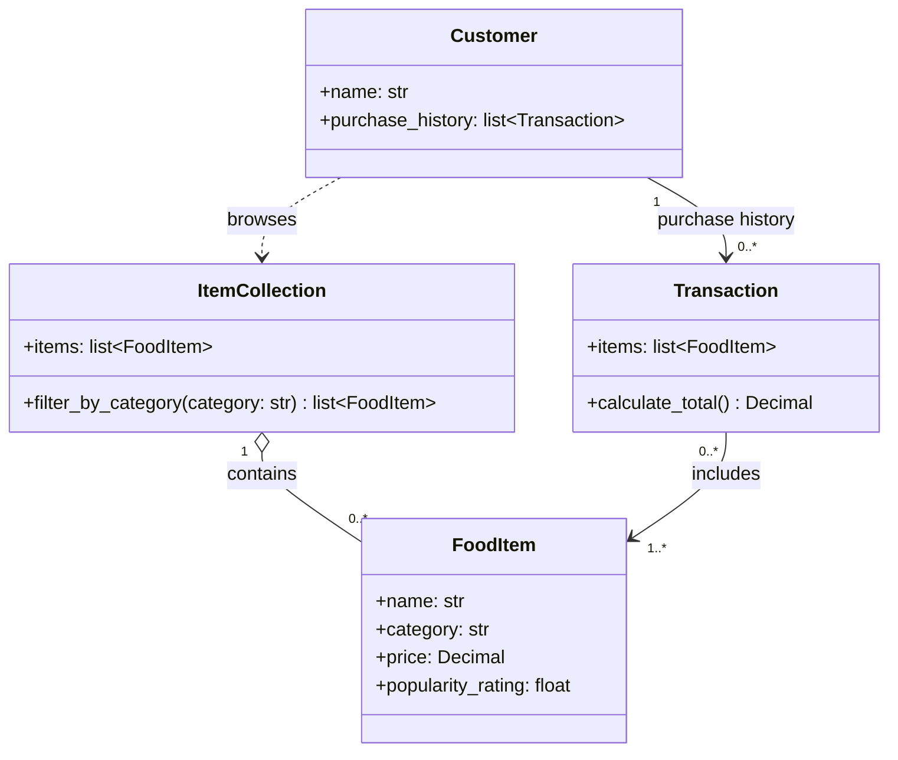

# Candidate Classes (name, price, category, popularity rating)
## Client Feature Request
We need to build the backend logic for the ByteBites app. The system needs to manage our customers, tracking their names and their past purchase history. Purchase history is for record keeping; it does not verify a user's identity.

These customers need to browse specific food items (like a "Spicy Burger" or "Large Soda"), so we must track the name, price, category, and popularity rating for every item we sell.

We also need a way to manage the full collection of items — a digital list that holds all items and lets us filter by category such as "Drinks" or "Desserts".

Finally, when a user picks items, we need to group them into a single transaction. This transaction object should store the selected items and compute the total cost from those items.

## Class Diagram

## Project Scope
Implement only `Customer`, `FoodItem`, `ItemCollection`, and `Transaction`
using straightforward in-memory operations. Do not add authentication, a
database, payment processing, or features beyond this specification.

## Behavioral Instructions
- Keep changes within the four classes and their stated responsibilities.
- Use Python type hints and simple, readable logic; use `Decimal` for prices and
  calculated totals.
- Filtering should return matching items without unexpectedly changing the
  collection.
- Treat `Transaction.calculate_total()` as a calculation over its items rather
  than separately stored total state.
- Do not infer authentication, persistence, payment, or other behavior from the
  purchase-history requirement.